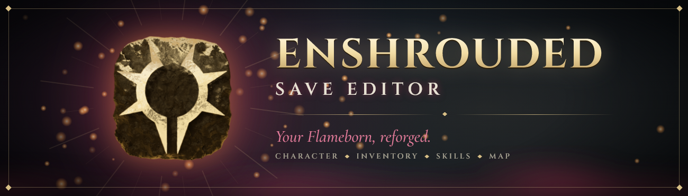
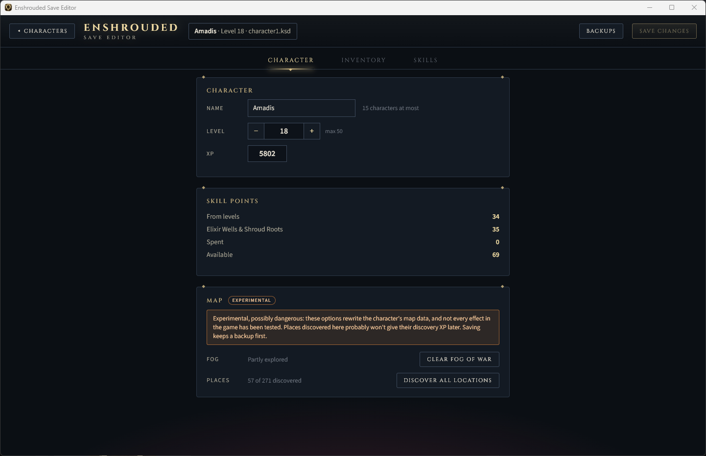
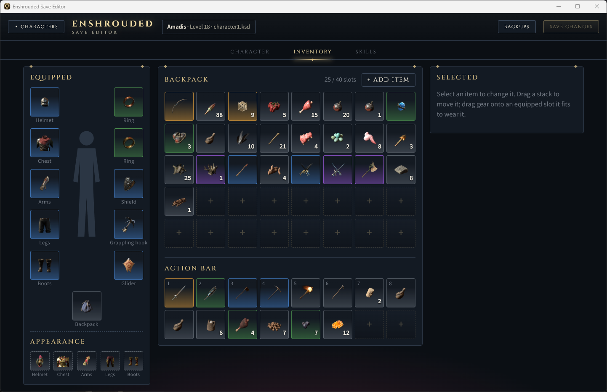
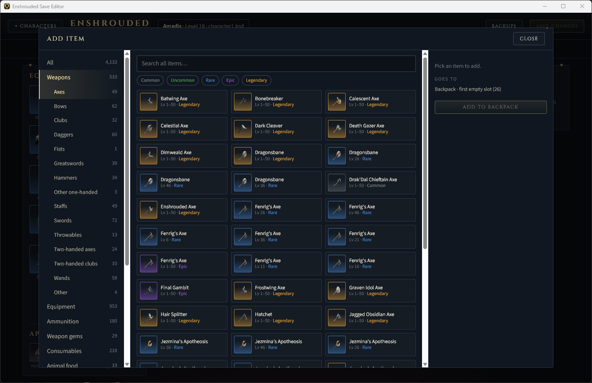
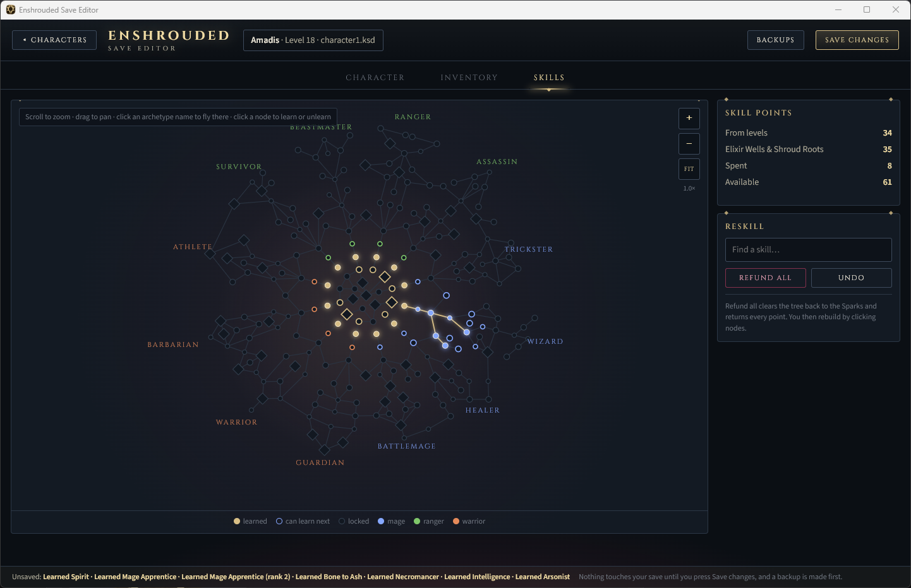

<p align="center">
  
</p>

<p align="center">
  <a href="https://github.com/MrAmadis/enshrouded-save-editor/releases/latest"><b>Download the latest release</b></a>
  &nbsp;·&nbsp;
  <a href="https://www.nexusmods.com/enshrouded/mods/244">Nexus Mods page</a>
</p>

A save editor for Enshrouded 1.0 characters, styled like the game. Pick a character, change it, and save back. The editor finds your Steam and local characters on its own and backs up the save before every change, so you can always go back.

## What you can edit

**Character**
- Name (up to 15 characters, as in the game's character creator), level and XP
- Skill points follow the level: raise it and the new points are ready to spend

**Inventory**
- Add any item in the game: browse by category, search by name or filter by rarity, with the game's own icons
- Change stack sizes, and the level, durability and rarity of gear
- Drag and drop to move, swap, equip and unequip. Only the slots an item fits will take it.

**Skills**
- The real skill tree, with zoom, pan and a skill search
- Learn, rank up and unlearn with a click, or **Refund all** to get every point back
- Unlearning a skill that others depend on unlearns those too, after asking
- The game's points budget applies: the game resets a skill tree that spends more points than the character has earned, so the editor warns before saving that

**Map** (experimental)
- **Clear fog of war:** reveal the whole map
- **Discover all locations:** mark the map's places as discovered

Both map options worked in testing, but not every effect in the game has been checked. Places discovered this way probably won't give their discovery XP later, and Ancient Spires aren't unlocked for fast travel.

## Screenshots

| Character | Inventory |
| --- | --- |
|  |  |
| **Add item** | **Skills** |
|  |  |

## Safe to use

- **Automatic backups.** Every save backs up the previous version first. The **Backups** button lists them and restores any of them.
- **Saves the game accepts.** The editor writes the checksums the game expects, leaves everything you didn't edit unchanged, and reads the file back to check it before saying it's saved. Its edits were checked by loading the saves in the game.
- **Steam Cloud keeps your edits.** Tested with Steam open and with Steam closed: Steam uploads the edited save when the game starts, with no conflict.
- **No accidents.** Nothing is written until you click **Save changes**. It won't save while Enshrouded is running, a save in a format it doesn't know opens read-only, and closing with unsaved edits asks first.
- **Hands off your game.** It only reads the game files and connects to nothing online.

## Install and use

**Requirements**
- Windows 10 or 11, 64-bit. Nothing to install: .NET is built into the exe.
- Microsoft Edge WebView2 Runtime. Windows 11 includes it, and most Windows 10 PCs already have it. If it's missing, the editor says so and opens Microsoft's download page.
- Enshrouded 1.0 character saves (`characterN.ksd`), Steam or local. Tested on the game's Steam update of October 21, 2026. Early Access saves aren't supported.

**Steps**
1. Download `EnshroudedSaveEditor-<version>.zip` from the [latest release](https://github.com/MrAmadis/enshrouded-save-editor/releases/latest) and unzip it anywhere.
2. Close Enshrouded. The editor won't save while the game is running.
3. Double-click `EnshroudedSaveEditor.exe`. Windows may say "Windows protected your PC" because the exe isn't signed: click **More info**, then **Run anyway**.
4. Pick a character. The first start reads the game files, which can take a moment.
5. Make your changes and click **Save changes**.
6. Start Enshrouded and load the character.

**Game or saves not found?** The editor finds Enshrouded in any Steam library by itself. Without the game files (or if a game patch makes them unreadable), it uses item and skill data built in from Enshrouded 1.0's launch: items show category symbols instead of their icons, and *Discover all locations* is turned off. The bottom of the character list shows which data is in use. If no characters show up, click **Choose saves folder** and pick the folder that holds your `characterN.ksd` files; the editor remembers it.

<details>
<summary><b>File locations and uninstalling</b></summary>

| What | Where |
| --- | --- |
| Steam characters | `<Steam>\userdata\<your id>\1203620\remote` |
| Local characters | `%USERPROFILE%\Saved Games\keen games\Enshrouded\<profile>` and `%USERPROFILE%\Saved Games\Enshrouded` |
| Backups | `%LOCALAPPDATA%\EnshroudedSaveEditor\backups` |
| Settings and caches | `%LOCALAPPDATA%\EnshroudedSaveEditor` |

The editor never touches the game's own backup folder or Steam's files.

To uninstall, delete `EnshroudedSaveEditor.exe`. To remove everything, also delete `%LOCALAPPDATA%\EnshroudedSaveEditor` (this deletes the backups too) and `%TEMP%\.net\EnshroudedSaveEditor` (files the exe unpacks on first run).
</details>

## Not supported (yet)

- Linux and Steam Deck
- Worlds: chests, bases and NPCs
- Appearance, item upgrades, and creating or deleting characters
- Fast travel to Ancient Spires you haven't reached

Found a bug? [Open an issue](https://github.com/MrAmadis/enshrouded-save-editor/issues) or post it in the Bugs tab on Nexus, with what you edited and whether it's a Steam or a local character.

## Building from source

You need Windows and the [.NET 10 SDK](https://dotnet.microsoft.com/download/dotnet/10.0) (10.0.401 or later; see `global.json`).

```powershell
dotnet build                                  # builds the solution
dotnet test                                   # runs the tests
dotnet run --project src/EnshroudedSaveEditor.App
```

Tests that need real saves (`tests/fixtures/real/`, not in the repo) or an Enshrouded install skip without them.

The release exe is a self-contained single file:

```powershell
dotnet publish src/EnshroudedSaveEditor.App -c Release -r win-x64 --self-contained `
  -p:PublishSingleFile=true -p:IncludeNativeLibrariesForSelfExtract=true `
  -p:EnableCompressionInSingleFile=true -p:Version=1.0.0 -o artifacts/publish
```

**Layout**

| Path | What it holds |
| --- | --- |
| `src/EnshroudedSaveEditor.Core` | Reading and writing `.ksd` saves: the container, the character records, the edits, backups |
| `src/EnshroudedSaveEditor.GameData` | Items, skills and icons, read from the game install, with built-in reference data as a fallback |
| `src/EnshroudedSaveEditor.UI` | The Blazor screens and tabs |
| `src/EnshroudedSaveEditor.App` | The Windows app (WinForms + Blazor WebView) that builds the exe |
| `tools/EnshroudedSaveEditor.Lab` | A command-line tool for save research: copy, dump, diff and watch characters |
| `docs/research` | Notes on the save format and the game's data files, and what was checked in-game |

## Credits

- [Kimikozi's Enshrouded Save Editor](https://codeberg.org/Kimikozi/enshrouded-save-editor) documented the item records and supplies the built-in item and skill data.
- [Brabb3l's kfc-parser](https://github.com/Brabb3l/kfc-parser) was the reference for reading the game's data files.
- Built with .NET, ASP.NET Core, Blazor WebView, the WebView2 SDK and ZstdSharp, with the Cinzel and Source Sans 3 fonts. See [THIRD_PARTY.md](THIRD_PARTY.md) for their licenses.
- Made with the help of Claude, an AI coding assistant.

Enshrouded and its icon belong to Keen Games. This is a fan-made tool, not made or endorsed by Keen Games.
